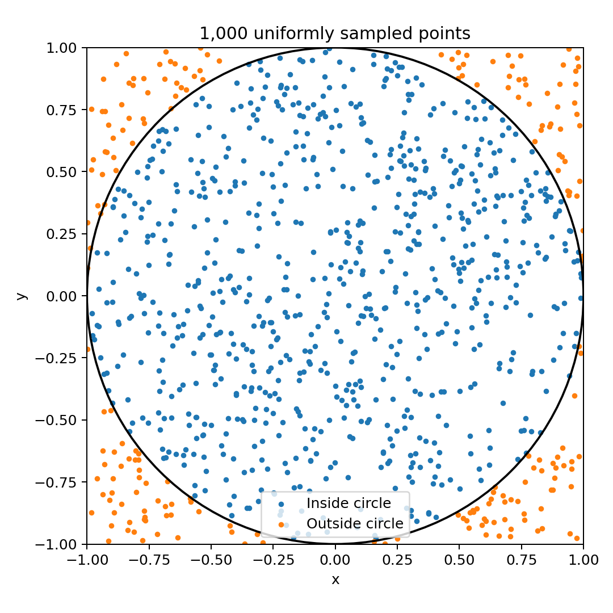
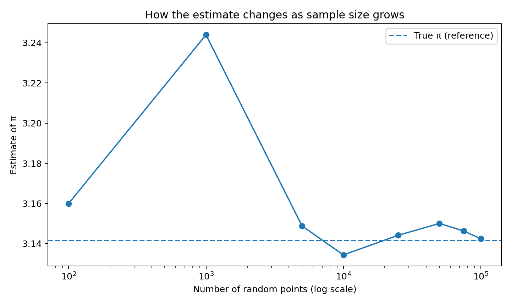
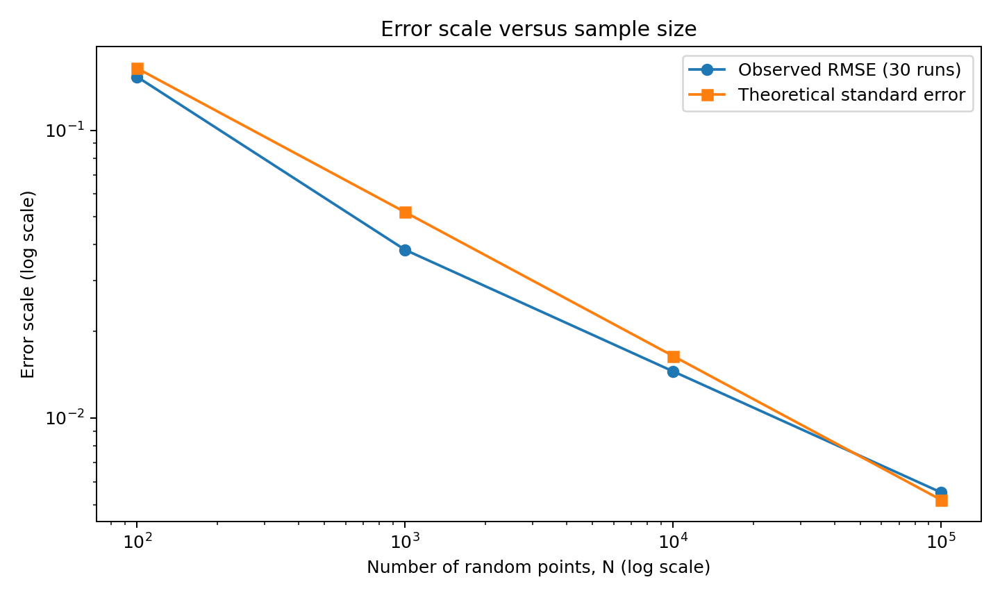

# Monte Carlo Estimation of π: A Computational Mathematics Project

**Exploring probability, random sampling, and statistical error using Python**

## Overview

This project investigates how Monte Carlo simulation can be used to estimate the mathematical constant π (pi). By generating uniformly distributed random points inside a square and counting how many fall within an inscribed circle, the program estimates π using probability.

The experiment compares different sample sizes across repeated simulations to investigate how the number of random points affects the accuracy and reliability of the estimate.

## Research Question

**How does increasing the number of randomly generated points affect the accuracy of a Monte Carlo estimate of π?**

## Mathematical Foundation

Consider a circle of radius 1 inscribed in a square with side length 2.

- Area of the circle: \(A_c = \pi\)
- Area of the square: \(A_s = 4\)

If points are uniformly distributed throughout the square, the probability that a point falls inside the circle is:

\[
P(\text{inside})=\frac{\pi}{4}
\]

If \(N\) points are generated and \(K\) fall inside the circle, the estimated value of π is:

\[
\boxed{\hat{\pi}=4\frac{K}{N}}
\]

As the number of sampled points increases, the estimate generally becomes more stable, although random variation means that every simulation can produce a different result.

## Experimental Method

The Python program performs the following steps:

1. Generates random coordinates \((x,y)\) within the square \([-1,1]\times[-1,1]\).
2. Checks whether each point satisfies \(x^2+y^2\leq 1\).
3. Counts the points that fall inside the circle.
4. Estimates π using the ratio of points inside the circle to the total number of points.
5. Repeats the experiment 30 times for each sample size.
6. Calculates summary statistics and generates graphs.

### Experimental Settings

| Parameter | Value |
|---|---|
| Sample sizes | 100, 1,000, 10,000, 100,000 |
| Repetitions per sample size | 30 |
| Total simulation runs | 120 |
| Master random seed | 20261010 |
| Programming language | Python 3 |
| Graphing library | Matplotlib |

## Results

The following table contains the results from the supplied simulation.

| Sample size | Mean π estimate | Mean absolute error | RMSE |
|---:|---:|---:|---:|
| 100 | 3.146667 | 0.128000 | 0.153388 |
| 1,000 | 3.134000 | 0.033091 | 0.038405 |
| 10,000 | 3.140733 | 0.011640 | 0.014522 |
| 100,000 | 3.142349 | 0.004487 | 0.005511 |

**Interpretation:** In these experiments, increasing the sample size was associated with lower average estimation error. The estimate based on 100,000 points had the smallest RMSE among the tested sample sizes.

These results illustrate the usefulness of repeated simulations and error metrics when evaluating a probabilistic algorithm.

## Visualizations

### 1. Sample Points

The plot illustrates randomly generated points and their positions relative to the unit circle.



### 2. Convergence of the Estimate

This graph illustrates how the running estimate of π changes as more points are sampled.



### 3. Error and Sample Size

This graph compares observed estimation error with the theoretical standard error across sample sizes.



## Statistical Analysis

Two error measures are used to evaluate the simulation:

**Mean Absolute Error (MAE)**

The average absolute difference between each estimate and the true value of π.

\[
\operatorname{MAE}=\frac{1}{R}\sum_{i=1}^{R}|\hat{\pi}_i-\pi|
\]

**Root Mean Squared Error (RMSE)**

The square root of the average squared difference between each estimate and π. This measure gives relatively greater weight to larger errors.

\[
\operatorname{RMSE}=
\sqrt{\frac{1}{R}\sum_{i=1}^{R}(\hat{\pi}_i-\pi)^2}
\]

Here, \(R\) represents the number of repeated simulations for a particular sample size.

## Project Structure

```text
pi-monte-carlo-lab/
├── README.md
├── pi_monte_carlo.py
├── research_report.pdf
├── replicate_results.csv
├── summary_results.csv
└── figures/
    ├── sample_points.png
    ├── convergence.png
    └── error_vs_sample_size.png
```

- **`pi_monte_carlo.py`** — simulation code.
- **`research_report.pdf`** — detailed research report.
- **`replicate_results.csv`** — individual simulation results.
- **`summary_results.csv`** — aggregated statistical results.
- **`figures/`** — visualizations generated by the program.

## How to Run the Project

### Option 1: Google Colab

1. Open [Google Colab](https://colab.research.google.com/).
2. Create a new notebook.
3. Upload `pi_monte_carlo.py` to the notebook environment.
4. Install Matplotlib if necessary:

   ```python
   !pip install matplotlib
   ```

5. Run the program:

   ```python
   %run pi_monte_carlo.py
   ```

6. Inspect the printed statistics, generated graphs, and CSV files.

### Option 2: Run Locally

Install Python 3 and Matplotlib, download the project files, and run:

```bash
python -m pip install matplotlib
python pi_monte_carlo.py
```

The script generates CSV files and plots in the current working directory.

## Reproducibility

The experiment uses a fixed master seed and derives a separate seed for each repetition. This makes the pseudo-random experiments reproducible when the code, settings, and relevant software behavior remain the same.

If the experiment settings or code are changed, rerun the program and update the report and results accordingly.

## Limitations

- Monte Carlo estimation is probabilistic and does not guarantee an exact result for a finite sample.
- Larger sample sizes require more computation.
- The experiment examines only four sample sizes and 30 repetitions per size.
- Results from one set of random simulations do not establish that every individual estimate improves as the sample size increases.
- Monte Carlo estimation of π is a well-established method; this project is an educational investigation, not a claim of a new mathematical discovery.

## Conclusion

This experiment demonstrates how probability and computational methods can be used to approximate a mathematical constant. The observed results show that larger sample sizes produced lower average errors in the tested simulations.

The project also demonstrates how Python can support mathematical experimentation through random sampling, statistical analysis, reproducible computation, and visualization.

## References

1. Python Software Foundation. [Python Documentation](https://docs.python.org/3/).
2. Matplotlib Development Team. [Matplotlib Documentation](https://matplotlib.org/stable/).
3. Weisstein, Eric W. [Circle — MathWorld](https://mathworld.wolfram.com/Circle.html).
4. Ross, Sheldon M. *A First Course in Probability*. Pearson.

---

**Author:** Rudresh Amale

**Project type:** Independent student computational mathematics project

**Topics:** Probability, Monte Carlo simulation, statistical error, Python programming, and data visualization.

*This project is intended for educational and research-learning purposes. The author should understand the method, verify the results, and describe their own contributions accurately.*
